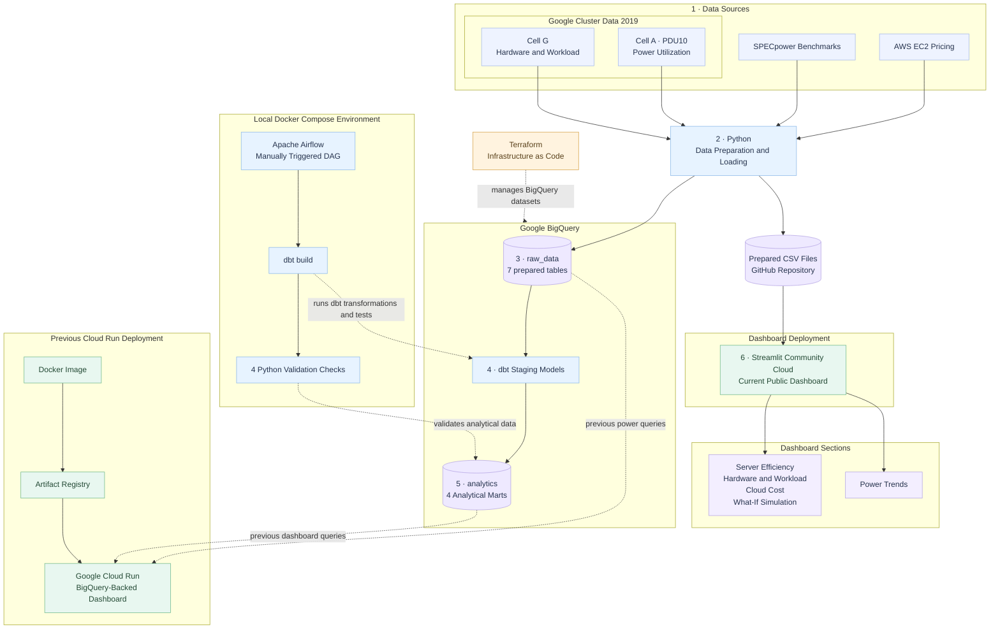

# ⚡ Data Center Hardware & Energy Efficiency

An end-to-end data engineering project integrating **SPECpower, Google Cluster Data 2019, and AWS EC2 Pricing** to explore server energy efficiency, hardware and workload characteristics, power utilization trends, and cloud infrastructure costs.

The project combines Python data processing, Google BigQuery, dbt, Apache Airflow, and Streamlit to transform multiple datasets into validated analytical models and interactive dashboards.

## Project Overview

Data centers must balance computing performance, energy efficiency, and infrastructure costs. This project explores how data engineering and analytics can support better infrastructure decisions.

**Main Question:** How can we identify energy-efficient server configurations without compromising performance?

### Project Objectives

- Analyze server performance and energy efficiency across hardware configurations.
- Explore machine hardware capacity and workload usage patterns.
- Examine normalized power utilization trends.
- Compare AWS EC2 instance configurations and estimated infrastructure costs.
- Develop interactive dashboards and scenario-based simulations.
- Build and validate analytical datasets through an orchestrated data pipeline.

## Data Sources

| Data Source | Purpose |
|---|---|
| SPECpower | Analyze server performance and energy efficiency across hardware configurations |
| Google Cluster Data 2019 — Cell G | Explore machine hardware capacity and sampled workload usage |
| Google Cluster Data 2019 — Cell A | Analyze normalized power utilization measurements |
| AWS EC2 Pricing | Compare cloud instance specifications and estimated infrastructure costs |

**Important:** Google Cluster Cell A power measurements and Cell G workload data are analyzed separately because they represent different cluster cells and cannot be directly joined.

## Technology Stack

| Technology | Role |
|---|---|
| Python & Pandas | Data extraction, cleaning, preparation, and validation |
| Google BigQuery | Cloud data storage and analytical querying |
| dbt | SQL transformations, analytical models, and automated data tests |
| Apache Airflow | Orchestration of dbt transformations and data quality validation |
| Streamlit | Interactive analytical dashboard and What-If Simulation |
| Git & GitHub | Version control and team collaboration |
| Docker | Containerized Apache Airflow environment |

## Project Structure

```text
data-center-energy/
├── airflow/
│   ├── checks/             # BigQuery data quality validation scripts
│   ├── dags/               # Airflow DAG definition
│   ├── Dockerfile
│   └── compose.yaml
├── dashboard/
│   ├── pages/              # Analytical dashboard pages
│   ├── app.py              # Streamlit home page
│   └── bigquery_utils.py   # BigQuery integration
├── data/                   # Local data extracts and processed datasets
├── dbt_project/            # dbt models, tests, and configuration
├── docs/                   # Analytical findings and project documentation
├── terraform/              # BigQuery dataset infrastructure
│   └── main.tf
├── pipelines/
│   ├── aws/                # AWS pricing processing and verification
│   ├── google/             # Google Cluster data processing
│   └── specpower/          # SPECpower exploration and analysis
├── requirements.txt
├── README.md
└── .gitignore
```

## Data Engineering Workflow



The project follows these main stages:

1. **Extract:** Collect selected datasets from SPECpower, Google Cluster Data, and AWS EC2 Pricing.
2. **Clean and Prepare:** Handle missing values, standardize columns, and prepare analytical datasets using Python.
3. **Store:** Load prepared datasets into Google BigQuery.
4. **Transform:** Use dbt to create structured analytical models.
5. **Validate:** Run dbt tests and Python-based data quality checks against BigQuery.
6. **Orchestrate:** Use Apache Airflow to coordinate transformations and validation tasks.
7. **Visualize:** Explore the analytical results through a Streamlit dashboard.

**Architecture Notes:**

- Python data preparation and loading run outside the current Airflow DAG.
- Cell A PDU10 power data and Cell G hardware and workload data come from different Google Cluster cells and are not directly joined.
- BigQuery stores seven prepared source tables in `raw_data` and four analytical marts in `analytics`.
- The manually triggered Airflow DAG runs `dbt build`, followed by four Python validation checks.
- Airflow runs locally through Docker Compose.
- The public dashboard is deployed on Streamlit Community Cloud from the `streamlit-community-cloud` branch.
- The current public dashboard reads prepared CSV files from the repository without requiring a live BigQuery connection. The original BigQuery-backed implementation is preserved on the `main` branch.
- Terraform manages the BigQuery datasets. Cloud Run and Artifact Registry are not managed by Terraform.

## Google BigQuery

**Google Cloud Project:** `data-center-hardware`

The project uses two BigQuery datasets:

- `raw_data` — Prepared source datasets.
- `analytics` — Analytical models produced through dbt.

The four main analytical marts are:

| Analytical Mart | Description |
|---|---|
| `mart_server_efficiency` | Server performance and energy efficiency |
| `mart_hardware_workload` | Hardware capacity and sampled workload characteristics |
| `mart_cloud_cost` | AWS EC2 instance specifications and pricing |
| `mart_power_trends` | Aggregated power utilization trends |

## dbt Transformation

dbt transforms the prepared BigQuery datasets into analytical models and runs automated data tests.

**Latest verified build result:**

```text
Completed successfully
PASS=27 WARN=0 ERROR=0 SKIP=0 NO-OP=0 TOTAL=27
```

This build included one table model, ten view models, and sixteen data tests.

## Apache Airflow Orchestration

Apache Airflow orchestrates the analytical transformation and validation workflow.

The DAG is named:

`data_center_hardware_energy_efficiency`

Its execution structure is:

```text
dbt_build
    |
    +----> check_server_efficiency
    |
    +----> check_hardware_workload
    |
    +----> check_cloud_cost
    |
    +----> check_power_trends
```

The four validation tasks depend on the successful completion of `dbt_build`. They are independent downstream tasks, although the current SequentialExecutor configuration executes them sequentially.

**Latest verified DAG execution:**

- DAG run status: **Success**
- Successful tasks: **5/5**
- Run type: Manual
- Execution date: October 12, 2026

The current DAG orchestrates **dbt transformations and analytical data quality validation**. Initial source extraction and loading are handled separately by the project’s preparation pipelines.

## Data Quality Validation

Four Python validation scripts verify the analytical marts in BigQuery.

| Validation Task | Dataset | Verified Rows |
|---|---|---:|
| Server Efficiency | `mart_server_efficiency` | 1,116 |
| Hardware & Workload | `mart_hardware_workload` | 987 |
| Cloud Cost | `mart_cloud_cost` | 87 |
| Power Trends | `mart_power_trends` | 744 |

All four validation scripts completed successfully in the latest verification.

The checks cover table accessibility, required columns, missing values, numeric validity, and dataset-specific quality constraints.

## Streamlit Dashboard

The interactive Streamlit dashboard provides five analytical sections:

1. **Server Efficiency:** Explore server performance and energy efficiency across hardware configurations.
2. **Hardware & Workload:** Examine hardware capacity and sampled workload characteristics.
3. **Cloud Cost:** Compare AWS EC2 instance specifications and pricing.
4. **Power Trends:** Explore normalized power utilization patterns over time.
5. **What-If Simulation:** Compare server recommendations under selected performance and full-load power constraints using SPECpower benchmarks.

The currently deployed dashboard reads prepared CSV datasets stored in the GitHub repository. The original dashboard implementation queried Google BigQuery.

## Running the Project

### Python Dependencies

Install the project dependencies:

```bash
pip install -r requirements.txt
```

### Streamlit Dashboard

From the project root directory:

```bash
streamlit run dashboard/app.py
```

The CSV-based dashboard does not require Google Cloud credentials. Install its dependencies with `pip install -r dashboard/requirements.txt` before running it locally.

### Airflow

The project uses Docker Compose for its local Airflow environment.

From the project root directory:

```bash
docker compose -f airflow/compose.yaml up -d --build
```

Open the Airflow interface on port `8080`, sign in using the locally configured account, and manually trigger the DAG.

A valid local Google Cloud authentication configuration and dbt profile are required.

Before starting Airflow, make sure that:

- `~/.dbt/profiles.yml` contains a valid `dbt_project` profile configured for BigQuery.
- Google Cloud authentication is configured locally and has the required BigQuery permissions.
- The local dbt profile directory is mounted read-only into the Airflow container through Docker Compose.

Validate the local dbt configuration and connection from the repository root:

```bash
dbt debug --project-dir dbt_project --profiles-dir "$HOME/.dbt"
```

## Cloud Infrastructure & Deployment

### Terraform Infrastructure

Terraform defines the existing Google BigQuery datasets:

- `raw_data` — Source and cleaned data.
- `analytics` — dbt analytical models and marts.

Terraform configuration is located in `terraform/main.tf`, using Google Cloud project `data-center-hardware` and the EU BigQuery location.

Both existing datasets were imported into local Terraform state. The latest `terraform plan` confirmed **No changes**, meaning the configuration matched the deployed datasets. Terraform state is local and is not committed to GitHub.

### Current Deployment: Streamlit Community Cloud

The public dashboard is deployed from the `streamlit-community-cloud` GitHub branch.

- **Hosting:** Streamlit Community Cloud
- **Main application:** `dashboard/app.py`
- **Dependencies:** `dashboard/requirements.txt`
- **Data source:** Prepared CSV files in the `data/` directory
- **Google Cloud credentials:** Not required for the public dashboard

**Live Dashboard:**

https://data-center-energy-efficiency.streamlit.app/

All five dashboard sections were tested successfully after deployment.

### Previous Deployment: Google Cloud Run

The original Streamlit dashboard was containerized with Docker and deployed through Google Artifact Registry to Google Cloud Run.

**Previous deployment architecture:**

`Streamlit → Docker → Artifact Registry → Cloud Run → BigQuery`

- **Cloud Run service:** `data-center-dashboard`
- **Region:** `europe-west1`
- **Authentication:** Service account with BigQuery access
- **Status:** Previous deployment; not the current public dashboard

The original BigQuery-backed implementation remains documented in the project and preserved on the `main` branch.

Airflow orchestration continues to be a separate, locally configured Docker Compose workflow.

## Data Limitations

- **Different Google Cluster cells:** Cell A power measurements and Cell G workload records cannot be directly matched.
- **Sampled workload data:** The instance usage dataset uses a limited sample rather than the complete workload dataset.
- **Time alignment:** Some machine capacity values may not be perfectly aligned with sampled usage observations.
- **Normalized power metrics:** Power utilization ratios are normalized values, not direct measurements of electricity consumption in kWh.
- **Scenario estimates:** What-If Simulation outputs represent hypothetical estimates and should not be interpreted as measured savings.
- **Pricing assumptions:** AWS EC2 cost estimates depend on the pricing attributes and assumptions represented in the selected dataset.

## Project Status

**End-to-end analytical pipeline implemented and successfully tested.**

Completed components include Python data preparation, BigQuery storage, dbt analytical models, Airflow orchestration, automated data quality validation, and Streamlit dashboard integration.

The project was developed as part of the **SDA × Le Wagon Data Engineering Bootcamp**.
